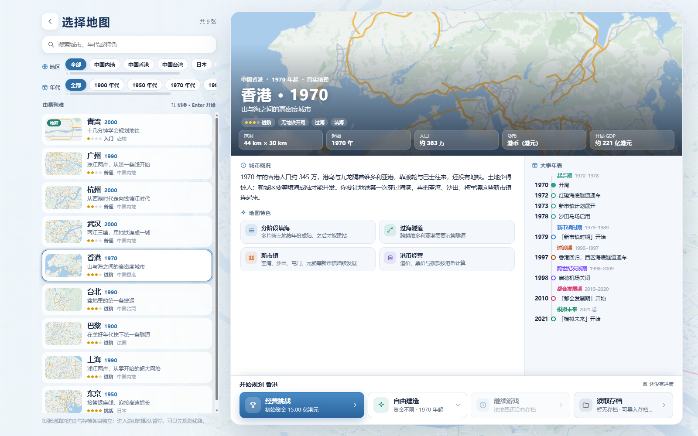
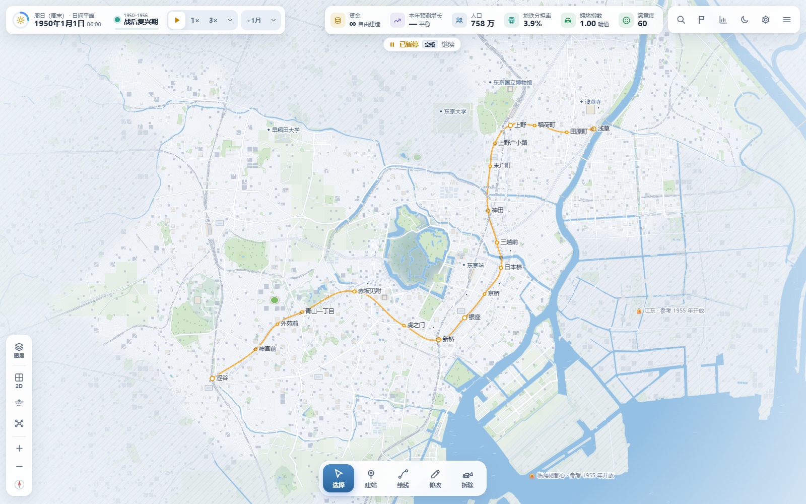
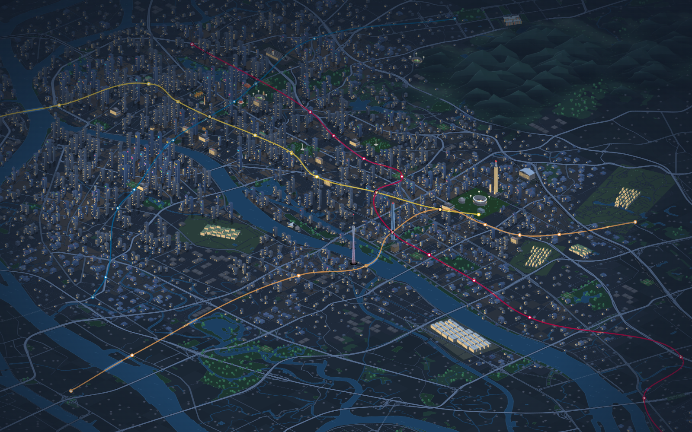
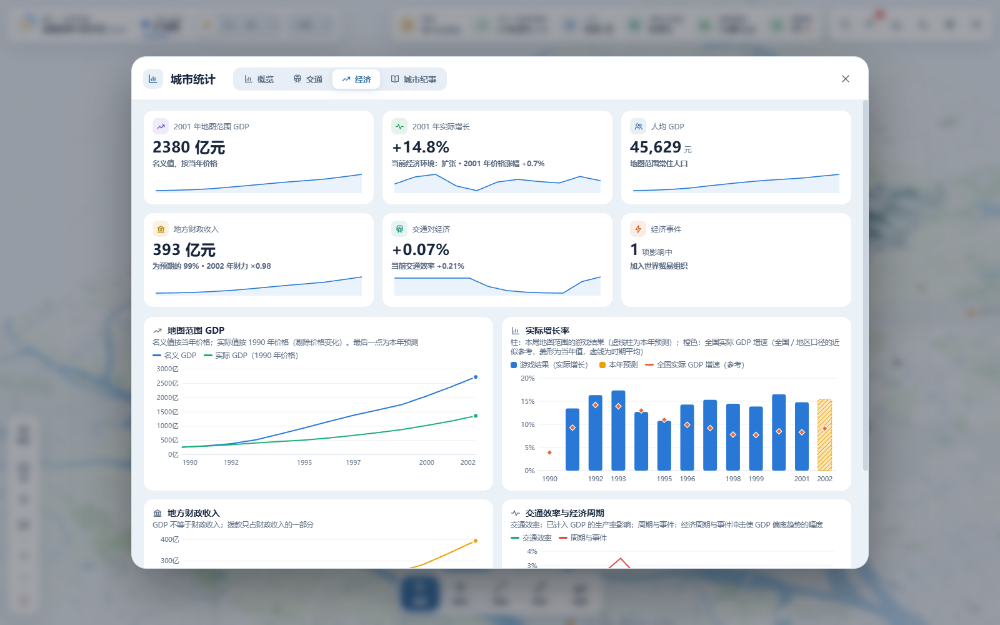

# City & Metro

[简体中文](./README.md) · [繁體中文](./README.zh-TW.md) · **English**

**Draw your own metro through real cities.**

City & Metro is a single-player metro planning and city management game for your browser. Start with one station, connect homes, business districts, campuses, and airports, cross rivers, and build a network of your own. Cities develop over time, and residents reconsider how they travel as your network grows.

**[Play online](https://city-and-metro.pages.dev)** · [Source repository](https://github.com/VinsonFung/city-and-metro) · [License](./LICENSE.txt)

## Maintenance and community editions

The original author, **VinsonFung**, will continue maintaining and updating this repository. **Please do not submit Pull Requests (PRs) to this repository.**

You are welcome to create a community edition under the non-commercial license and deploy it to your own website. Clearly identify it as a community modification and prominently display the following attribution and links:

- Original author: [VinsonFung](https://github.com/VinsonFung)
- Original game website: [City & Metro](https://city-and-metro.pages.dev)
- Original repository: [VinsonFung/city-and-metro](https://github.com/VinsonFung/city-and-metro)

**Commercial use of both the original game and community editions is strictly prohibited.** This includes paid access, sales, advertising, commercial sponsorship, and other monetization. Free distribution, modification, or renaming does not create an exception. Retain the license, copyright notices, and third-party attribution, explain your changes, and do not present a community edition as an official release.

Community-edition links will be collected and integrated into the original game website in the future, so players can discover and try different versions. Thank you for your understanding and cooperation.

## What you can do

- **Choose a city and era.** Eight real cities and the separate Qingwan tutorial have distinct geography, development stages, and local goals. Free Build also lets you choose a starting year and unlock construction across the map.
- **Design your network.** Build underground, surface, and elevated lines, curves, loops, branches, and multilevel interchanges. Adjust platform directions, split or merge lines, and preview or undo drafts before construction.
- **Run a city's metro.** Choose unlimited funds or balance construction, operations, fares, grants, and debt in financial challenges. Use ridership, congestion, walking coverage, and construction impact reports to plan your next move.
- **Grow with the city.** New districts, airports, campuses, and attractions open over time. Historical events affect travel and the economy; complete facility-access tasks and review stage summaries and the city chronicle. Airports outside the map show direction, distance, and demand beyond the boundary; connect a line to their boundary entrance to serve them.
- **Watch the city move.** Switch between 2D, 2.5D, and underground views, follow trains into stations, and watch street traffic, landmarks, and night scenes. Ambient sound changes with the area on screen.

Simplified Chinese, Traditional Chinese, and English are available under **Settings → Display → Language**. Desktop and phone layouts are included, with touch dragging and pinch-to-zoom.

During map loading, the city map fills the background as the logo is drawn stroke by stroke and stations light up. A metro-style progress bar tracks city, transport, and journey preparation. The animation follows the system's reduced-motion preference.

## Screenshots

Captured from the current repository version, **v2.2.0**, on **2026-10-29**.

### Choose your city

Each of the nine maps has an introduction, features, and a timeline grouped by era. Drag the region and era filters horizontally to see more options. Hong Kong is shown here, including its expanded island and airport area.



### Tokyo: begin with the Ginza Line

Start in 1950 with the Ginza Line's 18 stations between Asakusa and Shibuya. Study the neighborhoods and existing network in the daytime 2D view.



### Guangzhou: night on the Pearl River

Buildings, water, landmarks, and metro lines in 2.5D. This is the main menu's 2012 Guangzhou demonstration scene, with the interface hidden.



### From the network to the city economy

Economic statistics show GDP, growth, local finances, and transport efficiency. This separate Guangzhou Free Build demonstration began in 2000, built a five-station line, and advanced two years through normal settlement. Earlier chart data comes from the simulation leading up to the selected starting year. All figures are game simulation results.



## Cities and starting conditions

| Map | Default year | Planning features |
| --- | --- | --- |
| Qingwan | 2000 | Fictional city, 12-step tutorial, unlimited funds |
| Guangzhou | 1990 | The Pearl River, old city, Tianhe, Panyu, and University Town |
| Hangzhou | 2000 | West Lake, the Qiantang River, new districts, and Xiaoshan Airport |
| Hong Kong | 1970 | Mountains, harbor, new towns, reclamation, and Chek Lap Kok Airport |
| Taipei | 1990 | A basin, three rivers, and multiple urban centers |
| Tokyo | 1950 | Take over 18 Ginza Line stations; connect subcenters and Haneda Airport |
| Shanghai | 1990 | The Huangpu River, Pudong development, the World Expo, and Disneyland |
| Wuhan | 2000 | Three towns, two rivers, East Lake, Optics Valley, and Tianhe Airport |
| Paris | 1900 | A century of change, cross-city commuting, and two major airports |

All eight real cities support financial challenges and Free Build, with currency, fares, and financial parameters appropriate to each city and era. Later real-world metro lines do not appear automatically; you design the network.

## Running and saving

Open the [game website](https://city-and-metro.pages.dev) to play. You can also download this repository and open `index.html` in desktop Chrome, Edge, or Firefox, without installing dependencies or building the project.

Progress and settings are stored in your current browser; no account is needed. Autosaves, manual saves, save renaming, and JSON import/export are supported. Export a backup before changing computers, browsers, or website addresses. Unconfirmed construction drafts are not saved.

Supported older saves retain a raw backup before upgrading, preserving existing networks, fares, funds, debt, and past accounts. If loading fails, the save list offers an export of the original data.

## Common controls

Change bindings under **Settings → Controls**; in-game hints update with them.

| Action | Default controls |
| --- | --- |
| Pan / zoom | Left-drag, WASD / arrow keys; mouse wheel, `+` / `−` |
| Tools | `V` Select · `B` Build Station · `L` Draw Line · `E` Edit · `X` Demolish |
| Draw a line | Click points; `Shift` + click adds a bend; right-click / `Enter` finishes |
| Draft | `Ctrl+Z` Undo · `Ctrl+Y` Redo · `Ctrl+Enter` Confirm Build |
| Time | `Space` Pause / Resume; `1` / `2` / `3` / `4` select speed; `.` advances one month |
| Views | `T` 2D / 2.5D · `U` Underground · `K` Network Map · `F` Full Map |
| Shortcuts | `/` Search · `J` Tasks · `G` Statistics · `Ctrl+S` Save · `F10` Settings |
| Help / menu | `F1` Help; `Esc` pauses and opens the menu, or cancels / goes back in dialogs |

## Local development and deployment

Built with native HTML, CSS, and JavaScript. The [PRD](./PRD.md) documents gameplay and acceptance requirements; [js/news.js](./js/news.js) contains player-facing updates.

Build with Node.js, then deploy `dist/` to a static website host. Community deployments must follow the attribution and non-commercial requirements above.

```sh
node scripts/build.mjs
node scripts/verify-game.mjs --dist
```

Regression checks:

```sh
node scripts/test-map-migrations.mjs
node scripts/test-v22.mjs
node scripts/test-web-sync.mjs
```

## Copyright and license

**Copyright © 2026 VinsonFung. All rights reserved. Commercial use is strictly prohibited.**

Non-commercial study, research, play, modification, and sharing are subject to [LICENSE.txt](./LICENSE.txt). Third-party code, data, and assets retain their own licenses. OpenStreetMap geographic data is provided under ODbL 1.0; see the [third-party notices](./THIRD_PARTY_NOTICES.txt).
